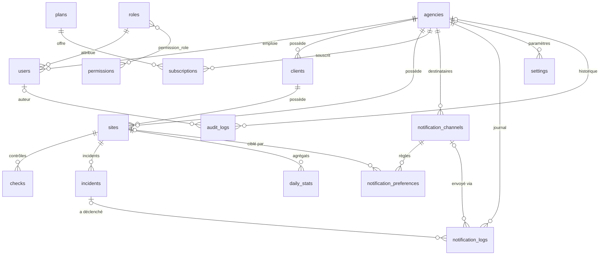

# Base de données

Schéma relationnel d'Uptime Africa : 18 tables applicatives + tables techniques Laravel.
Testé sur SQLite (développement) et MariaDB 10.11 (équivalent production Hostinger).

## Vue d'ensemble

## Tables

### Métier

| Table | Rôle | Clé | Isolation |
| --- | --- | --- | --- |
| `agencies` | Agences clientes de la plateforme | ULID | — |
| `clients` | Clients d'une agence | ULID | `agency_id` |
| `sites` | Sites surveillés | ULID | `agency_id` + FK composite vers le client |
| `checks` | Résultat de chaque contrôle | bigint | FK composite vers le site |
| `incidents` | Interruptions détectées | ULID | FK composite vers le site |
| `daily_stats` | Agrégats journaliers (conservés après purge des contrôles) | bigint | FK composite vers le site |
| `plans` | Offres d'abonnement (prix en FCFA) | bigint | globale |
| `subscriptions` | Abonnement d'une agence | bigint | `agency_id` |
| `notification_logs` | Journal des notifications envoyées | bigint | `agency_id` |

### Techniques

| Table | Rôle |
| --- | --- |
| `users` | Utilisateurs (`agency_id` NULL uniquement pour l'administrateur général) |
| `roles`, `permissions`, `permission_role` | Rôles système et leurs permissions |
| `sessions`, `password_reset_tokens` | Sessions web et réinitialisation de mot de passe |
| `audit_logs` | Historique des actions (qui, quoi, IP, navigateur, request_id) |
| `settings` | Paramètres clé/valeur globaux ou par agence |
| `notification_channels` | Destinataires d'alerte (email, WhatsApp) |
| `notification_preferences` | Pour un canal : sites concernés, événements, délai |
| `jobs`, `job_batches`, `failed_jobs`, `cache`, `cache_locks` | File d'attente et cache (Laravel) |

## Champs principaux

### `sites`

| Champ | Type | Description |
| --- | --- | --- |
| `name`, `url` | string | Nom, URL (2048 car. max) |
| `url_hash` | char(64) | SHA-256 de l'URL normalisée (unicité) |
| `client_id`, `agency_id` | ULID | Client et agence (même agence garantie en base) |
| `status` | `unknown` · `up` · `down` · `degraded` | Statut actuel |
| `monitoring_status` | `active` · `paused` · `disabled` | Statut de surveillance |
| `interval_minutes` | 1 à 1440 | Intervalle de vérification |
| `timeout_seconds` | 1 à 60 | Délai max d'une requête |
| `expected_status_codes` | JSON | Codes HTTP acceptés (défaut : 2xx/3xx) |
| `last_http_status`, `last_response_time_ms`, `last_checked_at` | — | Dernier contrôle |
| `next_check_at` | timestamp | Planification du prochain contrôle |
| `consecutive_failures` | entier | Échecs consécutifs |
| `monitoring_provider` | `internal` · `uptime_robot` · `better_stack` · `other` | Fournisseur de surveillance |
| `external_monitor_id` | string(100) | ID du moniteur externe |
| `sync_status` | `not_applicable` · `pending` · `synced` · `failed` | Statut de synchronisation |
| `last_synced_at`, `sync_error` | — | Dernière synchronisation |

### `incidents`

| Champ | Description |
| --- | --- |
| `site_id` | Site concerné |
| `started_at`, `resolved_at` | Début, résolution |
| `duration_seconds` | Calculée à la résolution |
| `type` | `downtime` · `timeout` · `dns_error` · `ssl_error` · `http_error` · `slow_response` |
| `description` | Texte libre |
| `status` | `open` · `acknowledged` · `resolved` |
| `confirmed_failures` | Nombre d'échecs confirmés |
| `last_http_status`, `last_error_message` | Dernière erreur constatée |
| `acknowledged_at`, `acknowledged_by` | Prise en charge |

### `subscriptions`

`status` (`trialing` · `active` · `past_due` · `cancelled` · `expired`), `billing_period`
(`monthly` · `yearly`), `price_xof` (prix figé), `starts_at`, `ends_at`, `trial_ends_at`,
`cancelled_at`, `payment_provider`, `payment_reference`.

### `notification_logs`

`channel_type`, `recipient` (copiés : l'historique survit à la suppression du canal), `event`
(`incident_opened` · `incident_resolved` · `channel_verification` · `test_message` ·
`subscription_reminder`), `status` (`queued` · `sent` · `failed` · `skipped`), `attempts`,
`provider_message_id`, `error_message`, `sent_at`.

## Contraintes d'intégrité

### Isolation par agence garantie en base

Les clés étrangères **composites** empêchent physiquement de relier deux agences :

| Table | Clé étrangère | Garantit |
| --- | --- | --- |
| `sites` | `(client_id, agency_id)` → `clients(id, agency_id)` | Le client du site est dans la même agence |
| `checks` | `(site_id, agency_id)` → `sites(id, agency_id)` | Le contrôle porte l'agence du site |
| `incidents` | `(site_id, agency_id)` → `sites(id, agency_id)` | Idem |
| `daily_stats` | `(site_id, agency_id)` → `sites(id, agency_id)` | Idem |
| `notification_preferences` | `(notification_channel_id, agency_id)` et `(site_id, agency_id)` | Canal et site de la même agence |

En complément, le trait `BelongsToAgency` filtre toutes les lectures et refuse toute écriture
vers une autre agence (voir `docs/architecture.md`).

### Unicités

| Règle | Implémentation |
| --- | --- |
| Une URL une seule fois par agence | `unique(agency_id, url_hash)` |
| Un ID de moniteur externe par fournisseur | `unique(monitoring_provider, external_monitor_id)` |
| **Un seul incident ouvert par site** | colonne générée `open_marker` + `unique(site_id, open_marker)` |
| **Un seul abonnement en cours par agence** | colonne générée `current_marker` + `unique(agency_id, current_marker)` |
| Une notification par incident, canal et événement | `unique(incident_id, notification_channel_id, event)` |
| Une préférence « tous les sites » par canal | colonne générée `all_sites_marker` |
| Un paramètre par clé (global ou par agence) | `unique(agency_id, key)` + `unique(global_marker, key)` |
| Un client de même nom par agence | `unique(agency_id, name)` |
| Un destinataire par type et agence | `unique(agency_id, type, destination)` |

### Suppressions

| Suppression de… | Effet |
| --- | --- |
| Agence | Cascade : utilisateurs, clients, sites, contrôles, incidents, abonnements, canaux, journaux, paramètres |
| Client | Cascade : ses sites et leurs données |
| Site | Cascade : contrôles, incidents, stats, préférences ; journal des notifications conservé (références mises à NULL) |
| Utilisateur | Historique des actions et prise en charge d'incidents conservés (NULL) |
| Offre souscrite | **Refusée** (`restrictOnDelete`) |
| Rôle attribué | **Refusée** |

### Contraintes CHECK (MySQL / MariaDB)

| Nom | Règle |
| --- | --- |
| `chk_sites_interval` | `interval_minutes` entre 1 et 1440 |
| `chk_sites_timeout` | `timeout_seconds` entre 1 et 60 |
| `chk_incidents_resolution` | `resolved_at` ≥ `started_at` |
| `chk_incidents_status` | `status = 'resolved'` ⇔ `resolved_at` renseigné |
| `chk_daily_stats_counts` | `checks_up` ≤ `checks_total` |
| `chk_daily_stats_percent` | `uptime_percent` entre 0 et 100 |
| `chk_subscriptions_period` | `ends_at` ≥ `starts_at` |

SQLite ne permet pas d'ajouter ces contraintes après coup : en développement, elles sont
assurées par les modèles et vérifiées par les tests ; le test dédié s'exécute sur MariaDB (CI).

## Index

Index posés pour les requêtes prévues : `sites(monitoring_status, next_check_at)` (sélection des
contrôles à lancer), `checks(site_id, checked_at)` (historique), `checks(checked_at)` (purge),
`incidents(agency_id, status, started_at)` (tableau de bord), `notification_logs(agency_id, created_at)`,
`audit_logs(agency_id, created_at)`. La table `checks` n'a volontairement que ces index (volume).

## Données de référence et données de test

| Type | Contenu | Commande |
| --- | --- | --- |
| Référence (toujours) | 5 rôles, 17 permissions (`config/permissions.php`) | inclus dans la migration ; resynchro : `php artisan db:seed` |
| Administrateur | compte `SUPER_ADMIN_EMAIL` | `php artisan db:seed` |
| **Test** (dév. uniquement) | 2 agences `[TEST]`, 4 utilisateurs `@example.com`, 4 clients, 6 sites example.com/.org/.net, 1 offre `test` à 0 FCFA, canaux email | `php artisan db:seed --class=TestDataSeeder` |
| Purge des tests | supprime tout ce qui est marqué test | `php artisan uptime:purge-test-data` |

Les données de test sont repérables par `agencies.is_test_data = 1`, le préfixe `[TEST]` et les
domaines réservés. Le seeder refuse de s'exécuter en production. Aucun contrôle ni incident n'est
inventé : ils seront produits par le moteur réel.

## Migrations

| Ordre | Fichier | Tables |
| --- | --- | --- |
| 1 | `0001_01_00_000000_create_agencies_table` | agencies |
| 2 | `0001_01_00_000001_create_roles_and_permissions_tables` | roles, permissions, permission_role (+ données de référence) |
| 3 | `0001_01_01_000000_create_users_table` | users, password_reset_tokens, sessions |
| 4 | `0001_01_01_000001_create_cache_table` | cache, cache_locks |
| 5 | `0001_01_01_000002_create_jobs_table` | jobs, job_batches, failed_jobs |
| 6 | `2026_10_30_000001_create_plans_and_subscriptions_tables` | plans, subscriptions |
| 7 | `2026_10_30_000002_create_clients_table` | clients |
| 8 | `2026_10_30_000003_create_sites_table` | sites |
| 9 | `2026_10_30_000004_create_checks_table` | checks |
| 10 | `2026_10_30_000005_create_incidents_table` | incidents |
| 11 | `2026_10_30_000006_create_daily_stats_table` | daily_stats |
| 12 | `2026_10_30_000007_create_notification_channels_and_preferences_tables` | notification_channels, notification_preferences |
| 13 | `2026_10_30_000008_create_notification_logs_table` | notification_logs |
| 14 | `2026_10_30_000009_create_settings_table` | settings |
| 15 | `2026_10_30_000010_create_audit_logs_table` | audit_logs |

## Choix techniques

- **ULID** pour les identifiants exposés dans les URL (non devinables, triables par date).
- **Colonnes générées** pour les unicités conditionnelles (MariaDB n'a pas d'index partiels).
  MariaDB refuse une colonne générée basée sur un `CHAR` : `notification_preferences.site_id`
  et `settings.agency_id` sont donc en `VARCHAR(26)`, compatible avec les clés étrangères.
- **Noms courts explicites** pour les clés composites (limite MySQL de 64 caractères).
- **Montants en entiers FCFA** (XOF n'a pas de subdivision).
- **Dates en UTC** ; affichage en `Africa/Abidjan` (UTC+0).
